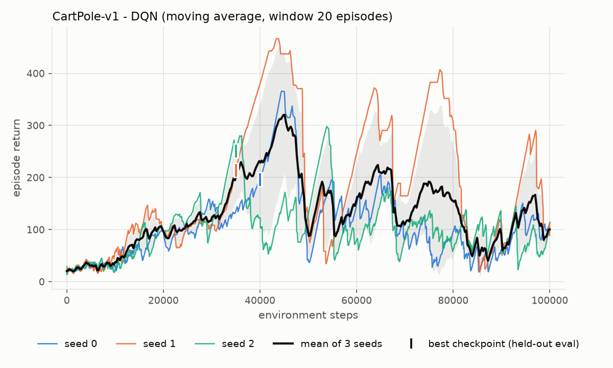
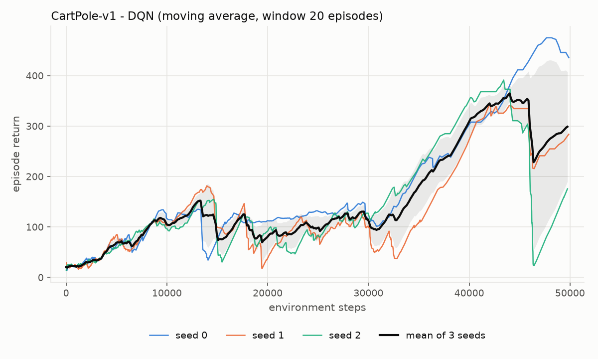
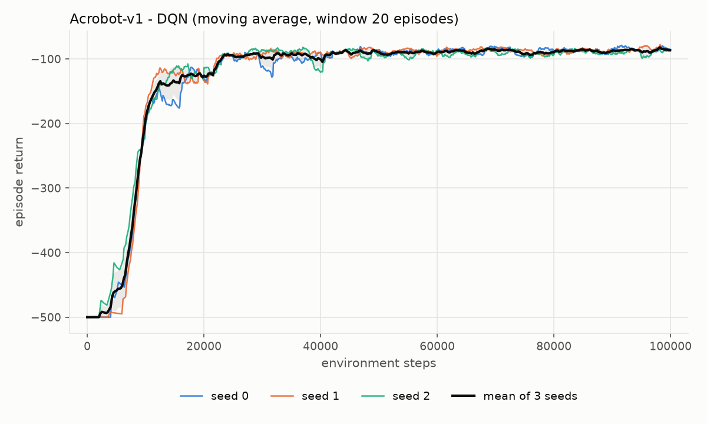
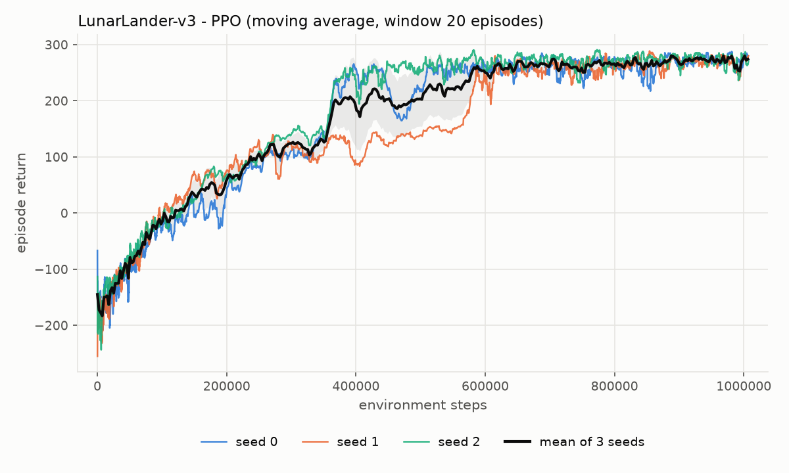

# rl-lab

Reproducible DQN and PPO baselines (stable-baselines3) on Gymnasium tasks:
CartPole-v1 and Acrobot-v1 with DQN, LunarLander-v3 with PPO. Every task is
trained on three seeds from a per-task YAML config, logged with `Monitor`, and
its final weights are evaluated with a deterministic policy on 20 held-out
seeds. Training can also evaluate on those seeds every N steps and keep the
best checkpoint (`--eval-every`); the table then reports that checkpoint next
to the final weights, labelled as such. The learning curves and the results
table below are regenerated from the run directories, not typed by hand, and
a test checks that they agree. Everything runs headless on a laptop CPU in
about 15 minutes. Two of the three tasks converged; the CartPole DQN run did
not: its final weights score 106 on average, while the best checkpoint of
every seed scores the maximum 500.

[](https://github.com/niharmaddina/rl-lab/actions/workflows/tests.yml)

## Results

Every number below was measured on 2026-10-12 (UTC) on an Apple M1 Pro
(macOS 26.6.2, CPU only, one torch thread per run; the wall times were taken
while up to nine runs shared the machine, three for the CartPole 100k row)
with Python 3.11.3 and the versions pinned in `requirements.txt` (torch
2.14.1, gymnasium 1.4.0, stable-baselines3 2.9.0). Each row is 3 training
seeds (0, 1, 2); each seed's final weights are evaluated for 20 episodes on
held-out reset seeds 10000..10019 with deterministic actions (`Final`). The
CartPole 100k row was trained with `--eval-every 5000`, which runs that same
evaluation every 5,000 steps during training and keeps the checkpoint with
the highest mean as `best_model.zip`; `Best-checkpoint` is that checkpoint
re-evaluated on the same 20 seeds, with the step at which it was saved. The
other rows were run before `--eval-every` existed and show a dash. `Wall
time / seed` is the training wall time; for the CartPole 100k row it includes
the 20 periodic evaluations (6-11 s of the 61-71 s per seed, recorded
separately as `in_training_eval_wall_time_s` in `results/summary.json`), so
that row is not a like-for-like timing against the 50k row. The table
is the verbatim output of `rl_lab.summarize` (`tests/test_results.py` checks
that it matches `results/summary.json`, which also holds the per-seed and
per-episode numbers).

| Env | Algo | Seeds | Timesteps / seed | Final return (mean +/- std across seeds) | Per-seed final | Best-checkpoint return (mean +/- std across seeds) | Per-seed best @ step | Wall time / seed |
|---|---|---|---|---|---|---|---|---|
| Acrobot-v1 | DQN | 3 | 100,000 | -74.3 +/- 5.1 | -67.8, -75.0, -80.3 | - | - | 2.0 min |
| CartPole-v1 | DQN | 3 | 100,000 | 106.1 +/- 68.2 | 42.6, 75.0, 200.7 | 500.0 +/- 0.0 | 500.0 @40k, 500.0 @35k, 500.0 @35k | 1.1 min |
| CartPole-v1 | DQN | 3 | 50,000 | 280.4 +/- 155.4 | 163.6, 500.0, 177.5 | - | - | 0.4 min |
| LunarLander-v3 | PPO | 3 | 1,000,000 | 278.5 +/- 1.6 | 277.2, 277.5, 280.8 | - | - | 12.0 min |

For scale: CartPole-v1 returns are capped at 500 per episode; Acrobot-v1 pays
-1 per step until the tip reaches the target height (-500 if it never does);
LunarLander-v3 counts an episode return of 200 as solved.

### Learning curves

Training-episode return (with the exploration noise of training, so below the
deterministic evaluation numbers above), 20-episode moving average, one thin
line per seed, thick line the mean across seeds with a +/- 1 std band. Where a
run has `evaluations.npz`, a vertical tick in the seed's colour marks the step
of its best checkpoint (CartPole 100k: 40k, 35k and 35k steps).









### What converged and what did not

* **Acrobot-v1 / DQN converged on every seed.** The curves rise from -500 to
  about -100 within 25k steps and stay there (the 20-episode average never
  drops below -130 afterwards); the final deterministic policies score -67.8,
  -75.0 and -80.3, a spread of 5.1 across seeds. The training average at 100k
  (-85 to -87) sits below the evaluation numbers only because training still
  acts with epsilon 0.1.
* **CartPole-v1 / DQN did not converge to a stable policy at 100k steps.** On
  all three seeds the training average climbs to a peak of 298-466 between
  43k and 54k steps, then falls back below 100 and oscillates between roughly
  20 and 400 for the rest of training, ending at 89-114; the final weights
  score 42.6, 75.0 and 200.7 on the held-out seeds.
  The 2024 script trained for exactly this budget and never measured the
  result; measured, the final policy is poor. This is the known instability
  of DQN on CartPole with these hyperparameters (rl-baselines3-zoo trains
  them for 50k steps, which is where the peaks are).
* **The best checkpoint of every CartPole seed scores 500.0 +/- 0.0, the
  task maximum, against a final 42.6 / 75.0 / 200.7.** With `--eval-every
  5000` each seed is evaluated 20 times during training on the held-out
  seeds. Seed 0 first reaches 500.0 on all 20 episodes at 40k steps, seeds 1
  and 2 at 35k, before the exploring training average peaks. The checkpoints
  kept at those steps score 500.0 +/- 0.0 again when reloaded, and 500.0 +/-
  0.0 on a further 20 seeds (20000..20019) they were not selected on, so the
  number is not an artefact of picking the best of 20 noisy estimates. What
  the periodic evaluations also show is that the policy does not stay there:
  the held-out mean is 500.0 in only 3 of 20 evaluations for seed 0
  (40k, 60k, 75k), 8 of 20 for seed 1 (35k-45k, 60k-75k, 95k) and 3 of 20 for
  seed 2 (35k, 45k, 50k), and in between it falls as low as 16.8 (seed 0,
  85k), 13.8 (seed 1, 90k) and 20.6 (seed 2, 90k); 7, 5 and 7 of each seed's
  20 evaluations are below 100. The final weights are not even the step-100k
  evaluation: DQN finishes its 256-step rollout at 100,096 steps and runs 128
  more gradient steps after that evaluation, which moves the held-out score
  from 135.0 to 42.6 (seed 0), 76.3 to 75.0 (seed 1) and 136.4 to 200.7
  (seed 2). The periodic evaluation only reads the policy, so the final
  weights, the episode returns and lengths in the Monitor logs, and the
  evaluation returns are identical to the earlier run without it (checked
  against the previous commit's `results/summary.json` and `curve.png`: the
  per-seed finals match to the digit, and the curve regenerated from the new
  Monitor logs without the ticks is byte-identical to the old figure). The
  20 evaluations cost 6-11 s of the 61-71 s of training per seed.
* **The 50k-step rerun shows the problem is the stopping point, not the
  budget.** Same kwargs, 50k steps. This is a separate run rather than the
  first half of the 100k one: `exploration_fraction: 0.16` is a fraction of
  the budget, so epsilon decays over 8k steps instead of 16k. Seed 1 scores a
  perfect 500.0 +/- 0.0 on all 20 evaluation episodes; seeds 0 and 2 score
  163.6 and 177.5. The training curve would not have predicted which: at 50k
  steps seed 0 had the highest training average of the three (436, just off
  a peak of 475), seed 1 was at 284 and recovering from a dip, and seed 2 had
  collapsed to about 25 at 46k and climbed back to 176. The greedy policy in the
  final weights is not what the exploring training curve shows, and whatever
  weights are on disk when training stops are what gets evaluated. The
  practical remedy is to keep the best checkpoint under periodic held-out
  evaluation, which is what `--eval-every` does in the 100k row above, not
  to tune the budget; it changes which weights are kept and reported, not
  the instability of the training itself (the 100k bullet above shows the
  held-out score falling back below 100 after each 500). This row was not
  re-run with it.
* **LunarLander-v3 / PPO converged on every seed.** The final policies score
  277.2, 277.5 and 280.8 (a spread of 1.6 across seeds), and every one of the
  60 evaluation episodes lands with a return above 250 (minimum 250.6, maximum
  311.0), well past the 200 that counts as solved. The seeds differ in how
  fast they got there: the 20-episode training average first crossed 200 at
  about 361k steps (seed 2) and 364k steps (seed 0), but only at about 577k
  steps for seed 1, which hovered between roughly 60 and 145 from 250k to
  500k steps before taking off. By 1M steps the training average of every
  seed is between 271 and 280. The PPO settings lifted from the 2024
  CarRacing script (n_steps 2048, batch 64, lr 2.5e-4, 4 envs, 64x64
  networks) transfer to this task without change.

The repository reports what the final weights do and, where a run kept one,
what the best checkpoint does, in separate columns; a best checkpoint is also
scored on seeds it was not selected on. It does not cherry-pick the best seed.

## What is here

```
rl_lab/
  train.py       train one (env, algo, seed) run; writes monitor csv, model.zip, eval.json
                 (--eval-every N: also best_model.zip and evaluations.npz)
  evaluate.py    load a model.zip and evaluate it on held-out seeds
  plot.py        learning curves across seed directories (moving average, PNG)
  summarize.py   aggregate eval.json files into results/summary.json + a Markdown table
  config.py      load/validate configs/<env>.yaml
  common.py      algorithm registry, env construction, seeded evaluation
configs/         CartPole-v1.yaml (dqn), Acrobot-v1.yaml (dqn), LunarLander-v3.yaml (ppo)
tests/           pytest: config loading, 500/2000-step train+eval round trips (with and without --eval-every),
                 summarize on both eval.json layouts, plotting, README/results consistency
scripts/         run_experiments.sh (launch everything in the README), make_results.sh (plots + summary)
results/         committed curves and summary.json; the runs/ directory with models is not committed
.github/         workflow that runs the tests on every push
```

## Install

```bash
python3.11 -m venv .venv && source .venv/bin/activate
pip install -r requirements.txt        # exact versions used for the results above
pip install -e .                        # adds rl-train / rl-evaluate / rl-plot / rl-summarize
```

`requirements.txt` pins the exact versions behind every number in this README
(torch 2.14.1, gymnasium 1.4.0, stable-baselines3 2.9.0, Python 3.11.3).
LunarLander-v3 needs `gymnasium[box2d]`; on macOS arm64 the `Box2D` wheel
installed from pip without a swig build. If box2d does not install on your
machine, the two DQN tasks still run (classic control has no extra
dependencies).

## Use

Train one run (the config supplies the algorithm kwargs; CLI flags override
`timesteps`, `n_envs`, `eval_episodes`):

```bash
python -m rl_lab.train --env CartPole-v1 --algo dqn --timesteps 100000 --seed 0 \
    --eval-every 5000 --out runs/CartPole-v1/dqn/seed_0
```

The run directory then contains `0.monitor.csv` (every training episode:
return, length, wall time), `model.zip` (the final weights), `config.yaml`
(the resolved config) and `eval.json`, whose `eval.final` block holds the
mean/std return of the final weights over 20 held-out seeds, plus timings and
library versions. With `--eval-every N` (0 = off) the same evaluation runs
every N environment steps during training; the directory then also holds
`evaluations.npz` (`timesteps`, `results`, `ep_lengths`, `seeds`) and
`best_model.zip`, and `eval.json` gains `eval.best` (that checkpoint
re-evaluated on the same seeds), `eval.best_step` and `eval.best_fresh_seeds`
(the same checkpoint on seeds 20000..20019).

Evaluate a saved model (20 episodes, seeds 10000..10019 by default; the
algorithm is read from the sidecar `eval.json`, so `best_model.zip` works the
same way):

```bash
python -m rl_lab.evaluate --model runs/CartPole-v1/dqn/seed_0/model.zip --env CartPole-v1 --episodes 20
python -m rl_lab.evaluate --model runs/CartPole-v1/dqn/seed_0/best_model.zip --env CartPole-v1 --seed-base 20000
```

Plot learning curves for a set of seeds and aggregate a results table
(`summarize` expects the `runs/<env>/<name>/seed_<k>/` layout that `train`
is given above):

```bash
python -m rl_lab.plot --runs runs/CartPole-v1/dqn/seed_* --out results/CartPole-v1/curve.png --window 20
python -m rl_lab.summarize --runs-root runs --out results/summary.json --hardware "Apple M1 Pro, CPU"
```

Reproduce everything in this README (twelve background processes, one per
seed; about 15 minutes wall-clock on the hardware above, the longest single
run being LunarLander seed 1 at 13.0 minutes) and rebuild the figures:

```bash
PYTHON=.venv/bin/python scripts/run_experiments.sh
PYTHON=.venv/bin/python scripts/make_results.sh
```

Run the tests (22 tests, about 6 s on CPU; the round-trip tests train 500- to 2,000-step DQNs):

```bash
pytest
```

## Seeds and evaluation protocol

* Training seed `k` seeds Python/NumPy/torch (`set_random_seed`), the
  environment reset, and the SB3 algorithm. Two runs with the same seed and
  config produce identical weights, Monitor logs and evaluation returns on
  this machine (`tests/test_train_eval.py::test_same_seed_is_reproducible`;
  also checked by hand on 2,000-step runs). This also held at full scale:
  the three LunarLander-v3 runs were trained twice end to end (the second
  time by accident, from a launcher script edited while the first launch was
  still running; `scripts/run_experiments.sh` is now written so that cannot
  recur), and the second pass matched the first at every checkpoint read off
  it (the 20-episode training average at 250k and 500k steps, the step at
  which each seed first crossed 200) and reproduced all 60 evaluation returns
  exactly. Only the second pass is archived here; it overwrote the first.
* Evaluation uses a fresh, unwrapped environment and 20 full episodes with
  reset seeds 10000..10019, disjoint from the training seeds 0, 1, 2. Actions
  are deterministic (argmax for DQN, the mean action for PPO).
* `Final return` in the table is the mean over seeds of each seed's
  20-episode mean; the `+/-` is the standard deviation of those per-seed
  means (so it measures seed-to-seed variation, not episode noise).
  `results/summary.json` also carries the pooled statistics over all 60
  episodes and the per-seed values.
* With `--eval-every N`, `rl_lab.common.HeldOutEvalCallback` (a subclass of
  SB3's `EvalCallback`) calls the same `evaluate_policy_seeded` function as
  the final evaluation every N environment steps: the same 20 reset seeds,
  the same deterministic actions. SB3's stock callback was not used as is
  because it resets its evaluation env without a seed, so its numbers would
  not be comparable with the final ones. The one difference is that a single
  `gym.make` env is reused across the periodic evaluations rather than
  created each time; every episode is re-seeded on reset, so the results are
  identical (`tests/test_train_eval.py::test_eval_every_writes_best_checkpoint`
  checks that `best_model.zip`, reloaded and re-evaluated, reproduces its
  periodic evaluation return for return). `best_model.zip` is overwritten
  only on a strict improvement of the mean, so ties keep the earliest
  checkpoint. The evaluation reads the policy and touches no training RNG;
  a run with `--eval-every` ends with the same weights as one without
  (`test_eval_every_does_not_change_training`, and the CartPole 100k row
  reproduced its earlier final returns exactly).
* `Best-checkpoint return` is selected on the same 20 seeds it is reported
  on, which biases it upward when evaluations are noisy. For that reason
  `train` also scores the best checkpoint on 20 further seeds,
  `eval_seed_base + 10000` onwards; the value is in `eval.json`
  (`eval.best_fresh_seeds`) and `results/summary.json`
  (`best_fresh_seeds_mean_return`), and for CartPole it is 500.0 on every
  seed. The final weights are not among the candidates: DQN with
  `train_freq: 256` keeps training past the last multiple of 5,000 (to
  100,096 steps), so `final` can be above or below the last periodic
  evaluation.

## Where the hyperparameters come from

The repository replaces three stand-alone scripts written in 2024 (DQN on
CartPole, PPO on CarRacing with `VecTransposeImage`, PPO on Humanoid/CartPole
with `make_vec_env`). Those scripts hard-coded one run each, rendered to a
window, assumed a CUDA device and saved nothing but the weights. Everything
here runs headless on a CPU, is driven from the command line, records what it
did, and evaluates every trained policy on seeds it never trained from.

* **CartPole-v1 / DQN.** The 2024 `CartPole/main.py` used `DQN("MlpPolicy", env)`
  with stable-baselines3 defaults and `total_timesteps=100000`. The MLP policy
  and the 100k budget are kept. The algorithm kwargs are the
  rl-baselines3-zoo CartPole-v1 DQN values (lr 2.3e-3, batch 64, buffer 100k,
  target update every 10 steps, train_freq 256 with 128 gradient steps,
  exploration fraction 0.16 to eps 0.04, two 256-unit layers); the SB3
  defaults are tuned for Atari (lr 1e-4, target update every 10k steps, 1M
  buffer) and are known to learn CartPole slowly and unstably.
* **LunarLander-v3 / PPO.** The 2024 `CarRacing/main.py` used PPO with
  `n_steps=2048`, `batch_size=64`, `learning_rate=2.5e-4`, four parallel
  environments and `net_arch=dict(pi=[64, 64], vf=[64, 64])`. All of those are
  reused verbatim. Its `use_sde=True` only applies to continuous action spaces
  and is dropped; `gamma=0.999`, `gae_lambda=0.98` and `ent_coef=0.01` are the
  rl-baselines3-zoo LunarLander values. CarRacing itself (pixel observations,
  `CnnPolicy`, `VecTransposeImage`) is not run here: it takes hours on a CPU
  and would dominate the budget of a repo meant to be re-run in minutes.
* **Acrobot-v1 / DQN.** No 2024 script covered it; the kwargs are the
  rl-baselines3-zoo Acrobot-v1 DQN values. Acrobot was chosen over
  MountainCar-v0 because epsilon-greedy DQN reliably solves it within 100k
  steps, whereas MountainCar's sparse reward usually needs more exploration
  machinery than this repository ships.
* The Humanoid script (`Humanoid/popcorn1.py`) actually trained PPO on
  CartPole with `make_vec_env`; its only reusable idea, the vectorised
  environment with Monitor wrappers, is what `rl_lab.common.make_training_env`
  does.

## Roadmap

* Done (2026-10-12): **best-checkpoint evaluation during training.**
  `--eval-every N` in `rl_lab.train` (an `EvalCallback` subclass running the
  final evaluation's protocol), `best_model.zip` and `evaluations.npz` in the
  run directory, `best` columns in `summarize` and the table, best-checkpoint
  ticks in `plot`. CartPole-v1 DQN was the test case: the best checkpoint of
  every seed holds 500 on the selection seeds and on 20 fresh ones.
* Plot the held-out evaluation curve from `evaluations.npz` next to the
  exploring training curve, and re-run Acrobot-v1 and LunarLander-v3 with
  `--eval-every` so every row has a best column.
* A DQN-defaults baseline next to the tuned CartPole run, to quantify how much
  the zoo hyperparameters are worth on this task.
* Hyperparameter sweeps driven from the same YAML files (a `sweep:` block
  expanded into one run directory per setting) and a `--resume` flag.
* MountainCar-v0 with a count-based or RND exploration bonus, to make the
  second DQN task harder than Acrobot.
* The original pixel-based CarRacing-v3 PPO config behind an optional extra,
  with a frame-skip wrapper, reported on a GPU box.

## License

MIT, Copyright (c) 2024-2026 Nihar Maddina. See `LICENSE`.
